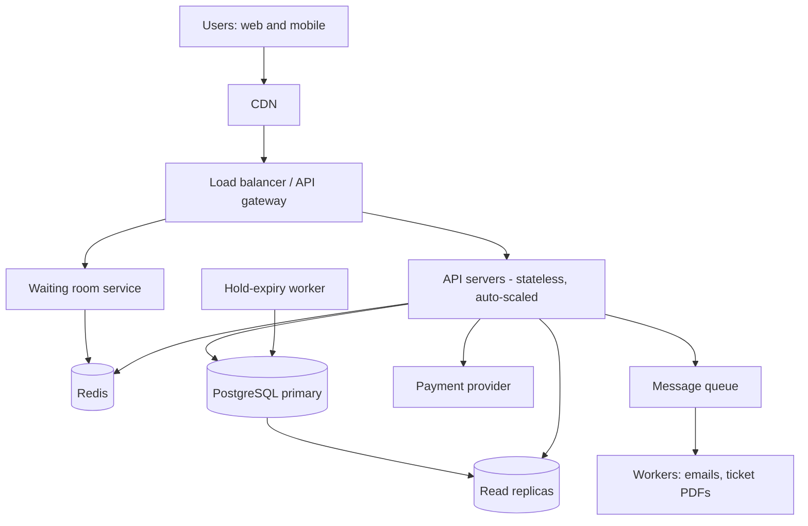

# TicketHub: System Design

TicketHub is a website that sells tickets for concerts and events. This document follows the six-part framework: requirements, estimates, API, data model, architecture, and trade-offs. It also explains how the design prevents two people from buying the same seat.

---

## 1. Requirements

### Functional requirements

1. Anyone can browse and search upcoming events (by date, city, artist).
2. A user can view an event's seat map and see which seats are available.
3. A registered, logged-in user can **hold** one or more seats for a short time (5 minutes) while they pay.
4. A user can pay for held seats and receive confirmed tickets.
5. A user can view their own tickets and past orders.
6. A user can release a hold, and holds that are not paid for expire automatically.

### Non-functional requirements

| Quality | Requirement |
|---|---|
| **Speed** | Browsing pages respond in under 300 ms (95th percentile). Seat map loads in under 500 ms. Holding a seat responds in under 1 second, even during a big sale. |
| **Correctness** | A seat is **never** sold to two people. A user is never charged for a seat they do not get. Payments are never charged twice if the user retries. Data about sold tickets is never lost. |
| **Fairness** | During a big sale, people are served roughly in the order they arrived. Bots and people opening many tabs cannot jump the line. A hold gives the user a guaranteed window to pay. |
| **Availability** | Browsing stays up even if payments are slow. 99.9% uptime, and during a big sale the site slows down gracefully (waiting room) instead of crashing. |
| **Scalability** | Handles at least 50x normal traffic during a sale without redesign. |
| **Security** | Passwords hashed, all traffic over HTTPS, card details never stored by us (payment provider handles them). |

**Priority when goals conflict:** correctness first, then fairness, then speed. A slow answer is acceptable; a double-sold seat is not.

---

## 2. Estimates

### Normal day

- Visitors: 50,000 per day, 10 pages each = **500,000 page views/day**.
- Average: 500,000 / 86,400 s ≈ **6 requests/second**.
- Traffic is not flat. Assuming most visits happen in a few evening hours, the peak is about 10x the average, so **~60 requests/second**.
- Sales: 5,000 tickets/day / 86,400 s ≈ **0.06 tickets/second**, which is almost nothing for a database.
- Storage: assume ~1 KB per ticket row. 5,000/day ≈ 5 MB/day, ~2 GB/year. Small.

### Big sale (popular concert)

- 200,000 people try to buy 20,000 seats in the first 10 minutes (600 seconds).
- Arrivals: 200,000 / 600 ≈ **333 new users/second**.
- Assume each user makes about 10 requests in that window (load page, load seat map, refresh the seat map a few times, try to hold, pay). That is 2,000,000 requests / 600 s ≈ **3,300 requests/second** on average, and perhaps **7,000/second** at the very first minute.
- Hold attempts: if each user tries about 3 times, that is 600,000 attempts / 600 s ≈ **1,000 hold attempts/second**.
- Competition: 200,000 buyers for 20,000 seats means **10 people for every seat**. Most attempts must fail cleanly.
- If the concert sells out, 20,000 orders / 600 s ≈ **33 orders/second**, but all hitting the same 20,000 seat rows.

### Comparison

| Metric | Normal day | Big sale (10 min) | Ratio |
|---|---|---|---|
| Requests/second (average) | ~6 | ~3,300 | ~550x |
| Requests/second (vs normal peak) | ~60 | ~3,300 to 7,000 | ~55x to 115x |
| Tickets sold | 5,000 per **day** | 20,000 in **10 minutes** | 4x a full day's sales in 0.7% of the time |
| Writes to the same rows | spread over many events | all on one event's seats | extreme contention |

**Conclusion:** the average load is easy; the sale is a short, violent spike concentrated on one event. We must design for the spike, and the hard part is not raw volume but **many people competing for the same 20,000 rows at the same time**. We should not scale the whole system for 24/7 peak; instead we absorb the spike with a queue, caching and a few extra servers added just for sale time.

---

## 3. API

REST over HTTPS, JSON bodies. Authentication via a bearer token (`Authorization: Bearer <token>`). Browsing endpoints are public.

| # | Method and path | Purpose | Auth |
|---|---|---|---|
| 1 | `GET /events?city=&date=&q=&page=` | Browse and search events | No |
| 2 | `GET /events/{eventId}` | Event details | No |
| 3 | `GET /events/{eventId}/seats` | View seats and their status | No |
| 4 | `POST /events/{eventId}/holds` | Hold seats for 5 minutes | Yes |
| 5 | `DELETE /holds/{holdId}` | Release a hold | Yes |
| 6 | `POST /orders/{orderId}/payments` | Pay for held seats | Yes |
| 7 | `GET /me/tickets` | View my tickets | Yes |
| 8 | `POST /events/{eventId}/queue` | Join the waiting room during a big sale | Yes |

### Examples

**3. View seats**

```
GET /events/42/seats?section=A
200 OK
{
  "eventId": 42,
  "seats": [
    { "seatId": 1001, "section": "A", "row": "1", "number": 1, "price": 1500, "status": "AVAILABLE" },
    { "seatId": 1002, "section": "A", "row": "1", "number": 2, "price": 1500, "status": "HELD" },
    { "seatId": 1003, "section": "A", "row": "1", "number": 3, "price": 1500, "status": "SOLD" }
  ]
}
```

This data may be up to a few seconds old (cached). It is a guide only; the real decision is made at hold time.

**4. Hold seats**

```
POST /events/42/holds
Idempotency-Key: 7c9e...
{ "seatIds": [1001, 1004] }

201 Created
{ "holdId": "h_881", "orderId": 5120, "expiresAt": "2026-10-25T19:05:00Z", "total": 3000 }

409 Conflict   (at least one seat is no longer available; nothing is held)
{ "error": "SEAT_UNAVAILABLE", "seatIds": [1004] }

429 Too Many Requests  (rate limit hit)
```

Holding is all-or-nothing: either every requested seat is held, or none is.

**6. Pay**

```
POST /orders/5120/payments
Idempotency-Key: 3b1f...
{ "paymentToken": "tok_abc" }

200 OK   { "orderId": 5120, "status": "PAID", "tickets": [ ... ] }
410 Gone { "error": "HOLD_EXPIRED" }
402 Payment Required { "error": "PAYMENT_DECLINED" }
```

The `Idempotency-Key` header means a retry (for example after a network timeout) returns the same result instead of charging twice.

**7. My tickets**

```
GET /me/tickets
200 OK
{ "tickets": [ { "ticketId": 9001, "event": "Band X", "date": "...", "seat": "A-1-1", "qrCode": "..." } ] }
```

Common rules: lists are paginated, 400 for invalid input, 401 if not logged in, 404 if not found.

---

## 4. Data Model

Relational database (PostgreSQL) because correctness and transactions matter most.

### Tables

**users**

| Column | Type | Notes |
|---|---|---|
| id | bigint PK | |
| email | text | UNIQUE, NOT NULL |
| password_hash | text | NOT NULL |
| name | text | |
| created_at | timestamptz | |

**venues**

| Column | Type | Notes |
|---|---|---|
| id | bigint PK | |
| name | text | |
| city | text | |

**events**

| Column | Type | Notes |
|---|---|---|
| id | bigint PK | |
| venue_id | bigint FK to venues.id | |
| title | text | |
| starts_at | timestamptz | |
| on_sale_at | timestamptz | when tickets go on sale |
| status | text | DRAFT, ON_SALE, SOLD_OUT, CANCELLED |

**seats** (the physical seats of a venue; a template)

| Column | Type | Notes |
|---|---|---|
| id | bigint PK | |
| venue_id | bigint FK to venues.id | |
| section, row, number | text | UNIQUE (venue_id, section, row, number) |

**event_seats** (one row per seat per event; this is what is actually sold)

| Column | Type | Notes |
|---|---|---|
| id | bigint PK | |
| event_id | bigint FK to events.id | |
| seat_id | bigint FK to seats.id | |
| price | int | in cents |
| status | text | AVAILABLE, HELD, SOLD |
| held_by_order_id | bigint FK to orders.id | NULL unless HELD or SOLD |
| hold_expires_at | timestamptz | NULL unless HELD |
| | | **UNIQUE (event_id, seat_id)** |

**orders**

| Column | Type | Notes |
|---|---|---|
| id | bigint PK | |
| user_id | bigint FK to users.id | |
| event_id | bigint FK to events.id | |
| status | text | PENDING, PAID, EXPIRED, CANCELLED |
| total | int | |
| hold_expires_at | timestamptz | |
| idempotency_key | text | UNIQUE per user |
| created_at | timestamptz | |

**tickets** (created only when an order is paid)

| Column | Type | Notes |
|---|---|---|
| id | bigint PK | |
| order_id | bigint FK to orders.id | |
| event_seat_id | bigint FK to event_seats.id | **UNIQUE**, so a seat can have at most one ticket |
| qr_code | text | |

**payments**

| Column | Type | Notes |
|---|---|---|
| id | bigint PK | |
| order_id | bigint FK to orders.id | |
| provider_ref | text | UNIQUE |
| amount | int | |
| status | text | |

### Relationships

- A **venue** has many **seats**, and many **events**.
- An **event** has many **event_seats**; each **event_seat** points to exactly one physical **seat**.
- A **user** has many **orders**; an **order** belongs to one **event**.
- An **order** holds many **event_seats** (through `held_by_order_id`), has many **tickets** and one or more **payments**.
- A **ticket** points to exactly one **event_seat** (one to one).

### Indexes

- `event_seats (event_id, status)` for fast "show available seats" queries.
- `event_seats (hold_expires_at) WHERE status = 'HELD'` for the expiry job.
- `orders (user_id, created_at)` and `tickets (order_id)` for "my tickets".

---

## 5. How double-booking is prevented

The danger is a **race condition**: two people see seat A-1-1 as free and both try to buy it at the same moment. A naive flow ("read the seat, if free, then save it") fails because both reads can happen before either write.

We prevent it with three layers. The database, not the application, makes the final decision.

### Layer 1: An atomic conditional update (the hold)

We never read first and then write. We do the check and the change in **one SQL statement**:

```sql
BEGIN;

-- seat ids are sorted first so every transaction locks in the same order (avoids deadlocks)
UPDATE event_seats
SET status = 'HELD',
    held_by_order_id = :order_id,
    hold_expires_at = now() + interval '5 minutes'
WHERE event_id = :event_id
  AND seat_id IN (:seat_ids)
  AND (status = 'AVAILABLE'
       OR (status = 'HELD' AND hold_expires_at < now()));

-- application checks the number of rows changed
-- if rows_changed <> number of seats requested: ROLLBACK and return 409
COMMIT;
```

When two transactions target the same row, PostgreSQL takes a **row lock** on it. The second transaction waits, then re-checks the `WHERE` condition against the new state. It no longer matches, so it updates 0 rows and gets a 409. Exactly one winner, no matter how many requests arrive at the same instant. Because the whole thing is one transaction, a hold of several seats is **all-or-nothing**: if one seat fails, the others are rolled back.

### Layer 2: Confirming at payment time

When the user pays, a second transaction confirms the sale:

```sql
BEGIN;
UPDATE event_seats
SET status = 'SOLD'
WHERE held_by_order_id = :order_id
  AND status = 'HELD'
  AND hold_expires_at > now();      -- hold must still be valid
-- rows_changed must equal the number of seats in the order, else ROLLBACK
INSERT INTO tickets (order_id, event_seat_id, qr_code) ...;
UPDATE orders SET status = 'PAID' WHERE id = :order_id;
COMMIT;
```

Money is only captured after the hold is confirmed valid, and the payment call uses the idempotency key so retries cannot charge twice. If payment fails, the order moves to CANCELLED and the seats go back to AVAILABLE.

### Layer 3: A constraint as the safety net

Even if a bug in our code skipped Layers 1 and 2, the schema itself refuses a double sale:

- `UNIQUE (event_id, seat_id)` on `event_seats` ensures there is only one sellable record per seat per event.
- `UNIQUE (event_seat_id)` on `tickets` ensures a seat can never have two tickets. The second insert fails with a constraint violation and the transaction rolls back.

### Expiry of holds

A background worker runs every few seconds and resets rows where `status = 'HELD' AND hold_expires_at < now()` back to AVAILABLE, and marks their orders EXPIRED. Layer 1 also accepts expired holds directly, so a slow worker never blocks sales.

### What we deliberately do not do

- We do **not** use the cached seat map (Redis/CDN) to decide whether a seat is free; it may be seconds stale and is only for display.
- We do **not** rely on a check in application code (`if seat.free`) before saving.

---

## 6. Architecture



### Components

- **CDN:** serves images, scripts and public event pages from locations close to users. During a sale, most requests (event page, posters, JavaScript) never reach our servers.
- **Load balancer / API gateway:** spreads requests across API servers, terminates HTTPS, checks health, and applies **rate limits** per user and per IP to slow bots.
- **Waiting room service:** when a big sale starts, users are placed in a queue (position decided by arrival time, with a random shuffle for people arriving in the first few seconds before the sale opens, to be fair to slow connections). It admits users in batches (for example 500 at a time) so that the number of people actively choosing seats matches what the database can handle. Queue state lives in Redis.
- **API servers:** stateless application servers that implement the endpoints. Because they keep no state, we can add more before a sale and remove them afterward.
- **Redis:** (a) caches the seat map for 1 to 2 seconds so that thousands of "view seats" requests are answered from memory; (b) stores the waiting room queue and rate-limit counters; (c) stores session data. It is never the source of truth about who owns a seat.
- **PostgreSQL primary:** the single source of truth for seats, holds, orders and tickets. All holds and payments go through it, which is what makes the row locks in section 5 work.
- **Read replicas:** copies of the database used for browsing, search and "my tickets", so reads do not compete with sale writes.
- **Payment provider:** an external service that handles card details. Our API calls it only after a valid hold is confirmed.
- **Message queue and workers:** after payment, emails and ticket PDFs are produced asynchronously so the buyer's request is not slowed down, and failures can be retried.
- **Hold-expiry worker:** releases seats whose hold has run out.

### How it survives the big sale

1. **Most traffic never touches the database.** The CDN absorbs static content and Redis absorbs seat-map reads, so the roughly 3,300 to 7,000 requests/second are mostly served from memory.
2. **The waiting room controls the flood.** Instead of 200,000 people hitting the hold endpoint at once, only a limited batch is active at any moment, so database writes stay at a few hundred per second at most, which a single well-indexed primary can handle.
3. **Contention is limited to a short, simple transaction.** A hold is one small `UPDATE` on a few rows with an index; row locks are held for milliseconds.
4. **Scale in advance.** We know the sale time, so we add API servers and warm the cache beforehand (scheduled scaling), rather than waiting for automatic reaction.
5. **Failures degrade gracefully.** If payments are slow, holds stay valid for 5 minutes and browsing continues. If the cache is lost, requests fall back to replicas. If an API server dies, the load balancer stops sending it traffic.
6. **Fairness and bot protection.** Rate limits, one active queue place per account, and a limit on seats per order (for example 6).

---

## 7. Trade-offs

### Trade-off 1: Waiting room (fairness and stability) vs. user friction

**Choice:** use a waiting room during big sales.
**Gain:** the database is protected, the site stays up, and people are served in a fair order.
**Cost:** some users wait many minutes and may give up; it adds a component to build and operate. Users in the queue also cannot see seats, which can feel frustrating.
**Why we accept it:** a crashed site would be worse for everybody, and unfairness to genuine buyers is a core non-functional requirement.

### Trade-off 2: Strong consistency (PostgreSQL) vs. raw scale (a faster in-memory store)

**Choice:** keep seat ownership in a relational database with transactions and constraints, instead of putting it in Redis or a NoSQL store that scales more easily.
**Gain:** simple, provably correct protection against double-booking, with a constraint as a safety net.
**Cost:** a single primary database is the bottleneck for writes. Scaling it needs vertical growth, partitioning by event, or the waiting room to throttle load.
**Why we accept it:** at 33 sales/second and about 1,000 hold attempts/second, one database is enough if we shield it, and correctness matters more than maximum speed.

### Trade-off 3: Cached seat map (speed) vs. up-to-date display (accuracy)

**Choice:** cache the seat map for 1 to 2 seconds.
**Gain:** huge reduction in database reads.
**Cost:** users sometimes click a seat that shows as free but is already held, and get a 409 error. This is a worse experience but never an incorrect sale, since the real decision is made in the database.
**Mitigation:** the UI refreshes the map after a failed hold and highlights the seats just lost.

### Trade-off 4: Length of the hold (5 minutes)

A short hold makes seats come back faster (more fairness to people waiting) but may not give a slow payer enough time. A long hold is kind to buyers but lets people "hide" seats from others. We pick 5 minutes with a visible countdown, and allow one extension only for orders that have already started payment.
